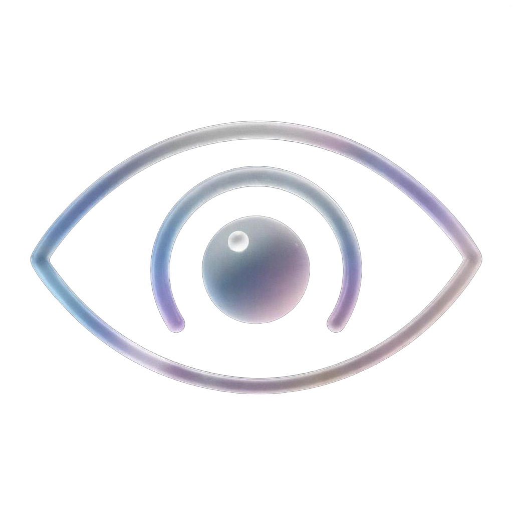

<div align="center">



# iGlance

### A lightweight macOS menu bar utility for monitoring your system at a glance.

[](https://www.apple.com/macos/)
[](https://swift.org)
[](LICENSE)
[](https://github.com/kuicao55/iGlance/releases)
[](https://github.com/kuicao55/iGlance)

[Features](#-features) · [Installation](#-installation) · [Usage](#-usage) · [Build](#-build-from-source) · [Roadmap](#-roadmap) · [License](#-license)

</div>

---

## 👁️ What is iGlance?

**iGlance** lives quietly in your menu bar and shows you what your Mac is doing — CPU, GPU, memory, temperature — without opening Activity Monitor. Need to keep your machine awake during a long render? One click. Want to see what background jobs are scheduled? One click. No Dock icon, no clutter, no waiting.

Designed native-first: pure **SwiftUI + AppKit**, no Electron, no web view, no dependencies.

---

## ✨ Features

### 📊 Monitor
- **CPU, GPU, Memory, Temperature** — real-time readings on a 2×2 grid of animated gauges
- **Sparkline charts** — 60-second rolling history per metric
- **Tap-to-flip cards** — click any card (except Temperature) for detailed history and top processes
- **Color-coded thresholds** — green / yellow / orange / red as load climbs

### 💤 Status
- **Prevent System Sleep** — holds an `IOPMAssertion` so your Mac won't nap mid-task
- **Prevent Display Sleep** — keeps the screen awake for presentations
- **SleepDisabled indicator** — see when *another* process is holding your Mac awake

### 📅 Tasks
- **LaunchAgents** &nbsp;·&nbsp; **LaunchDaemons** &nbsp;·&nbsp; **cron** &nbsp;·&nbsp; **at**
- See labels, schedules, and running status of every background job you have permission to inspect

### 🎯 Menu Bar
- **Dynamic load indicator** — a tiny arc on the menu bar icon grows with system load (weighted average of CPU/GPU/Memory/Temp)
- **Template-rendered** — automatically adapts to Light / Dark menu bar
- **Click to open** — popover anchors directly under the menu bar icon

### 🪟 The Look
- macOS 14 native design language with subtle Liquid Glass surfaces
- 440 × 520 fixed-size popover, optimized for glanceable density
- 2-second refresh interval, automatic cleanup of power assertions on quit

---

## 📦 Installation

### Download (recommended)

Grab the latest `.app.zip` from the [**Releases page**](https://github.com/kuicao55/iGlance/releases/latest), then:

```bash
# Unzip, then move to Applications
open ~/Downloads/iGlance.app.zip
cp -R ~/Downloads/iGlance.app /Applications/
open /Applications/iGlance.app
```

> First launch: macOS will ask you to confirm opening an app from the internet. Click **Open**.

### Build from source

Requires **macOS 14+** and **Swift 5.9+** (Xcode 15 / Command Line Tools).

```bash
git clone https://github.com/kuicao55/iGlance.git
cd iGlance
./build-app.sh
open iGlance.app
```

`build-app.sh` compiles a release binary, assembles the `.app` bundle, embeds the icon, and ad-hoc code-signs the result.

---

## 🚀 Usage

1. Launch iGlance — the eye icon appears in your menu bar
2. **Click it** to open the popover
3. Switch between the **Monitor** / **Status** / **Tasks** tabs
4. The menu bar icon's arc fills as your system load increases

> The menu bar icon lives under the date/time by default. Drag it out, or add it to *Always Shown* via **System Settings → Menu Bar**.

### Command-line build options

```bash
swift build                  # Debug build (fast, unoptimized)
swift build -c release       # Release build (optimized)
./build-app.sh               # Bundle the release build into iGlance.app
```

---

## 🏗 Architecture

| Layer | Tech | Notes |
|---|---|---|
| UI | SwiftUI + AppKit | NSPopover anchors UI to menu bar |
| State | Combine + ObservableObject | `AppStore` / `MonitorStore` / `StatusStore` / `TasksStore` |
| Data | `top`, `ioreg`, `vm_stat`, `memory_pressure`, `powermetrics` | Hardware-dependent sensors gracefully degrade |
| Power | IOKit `IOPMAssertion` | Auto-released on quit |
| Build | SwiftPM + `build-app.sh` | No Xcode project required |

```
Sources/iGlance/
├── App/           # Lifecycle, AppDelegate, scene plumbing
├── Controllers/   # Status item + popover controllers
├── Models/        # Data structures
├── Services/      # CPU/GPU/Memory/Temp providers, power mgmt, task discovery
├── Stores/        # Reactive state
├── Support/       # Logging, utilities
└── Views/         # SwiftUI views (cards, gauges, sparklines, tabs)
```

---

## 🧪 Verified

All 12 automated tests pass — see `verify-all-features.sh` and `FINAL_TEST_REPORT.md`.

- ✅ Build & launch
- ✅ Menu bar presence (LSUIElement)
- ✅ Live CPU / GPU / Memory / Temp data
- ✅ Card flip animations
- ✅ Sleep assertion toggle + cleanup
- ✅ LaunchAgent / LaunchDaemon / cron / at discovery

---

## 🗺 Roadmap

- [ ] Homebrew Cask (`brew install --cask iglance`)
- [ ] DMG installer with drag-to-Applications UX
- [ ] Customizable refresh interval (currently fixed at 2s)
- [ ] Threshold-based notifications (e.g. alert when CPU > 90% for 30s)
- [ ] Menu bar icon style options (gauge, percentage, sparkline)
- [ ] Export monitoring history to CSV
- [ ] Localization

---

## 🤝 Contributing

PRs welcome. Before opening one:

1. Run `./verify-all-features.sh` — all tests must pass
2. Keep changes focused; one feature per PR
3. Match the existing Swift style (4-space indent, no external dependencies)
4. If you change UI, attach a screenshot

---

## 📄 License

[MIT](LICENSE) © 2024 kui.

---

## 🙏 Credits

Built with love and a lot of `man powermetrics`.

<div align="center">

**[⬇ Download](https://github.com/kuicao55/iGlance/releases/latest)** · **[🐛 Report Bug](https://github.com/kuicao55/iGlance/issues)** · **[✨ Request Feature](https://github.com/kuicao55/iGlance/issues)**

</div>